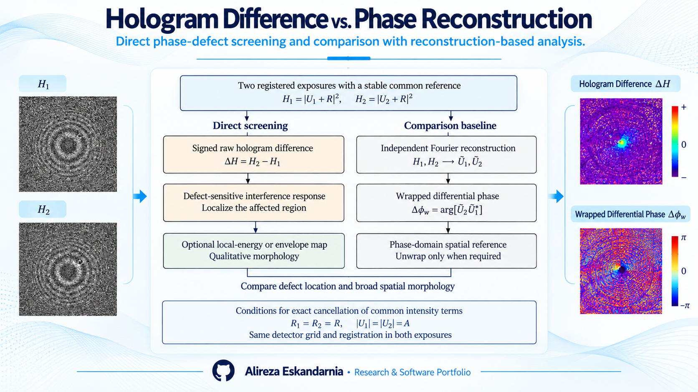
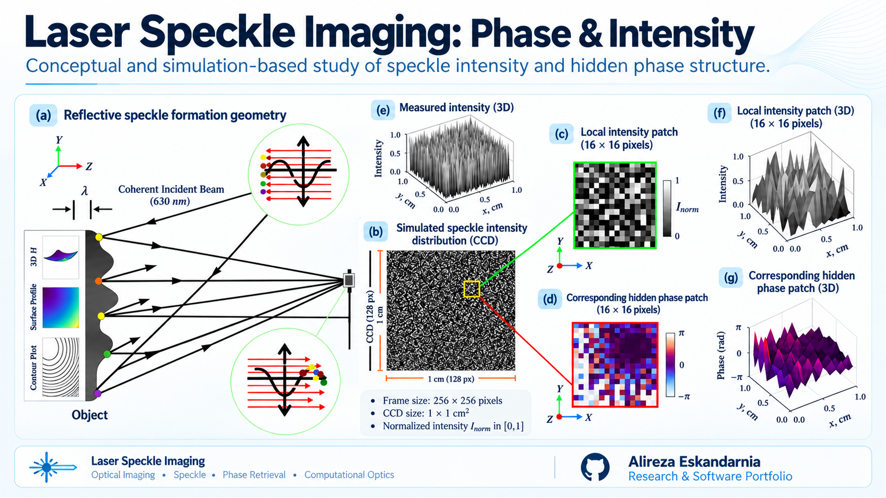
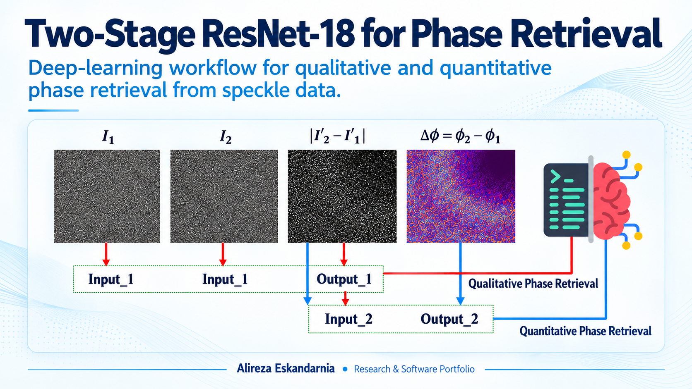

<!-- Academic and software portfolio showcase. No source code is included. -->
# Laser Speckle Digital Holography: Surface Defect Analysis & Phase Retrieval

**Computational Imaging · Digital Holography · Laser Speckle · Optical Metrology · Deep Learning**

A research showcase bringing together related numerical investigations of coherent speckle formation, surface phase-defect screening, and phase retrieval. The three components below are **distinct research approaches**, not a single end-to-end algorithm.

## 1. Raw Hologram Differencing vs. Phase Reconstruction

Two registered intensity holograms are compared through **direct raw-hologram differencing**, with independently reconstructed differential phase used as a reference pathway. The pre-reconstruction difference is intended for **qualitative defect-sensitive screening**; it is not presented as a direct quantitative phase measurement.

## 2. Laser Speckle Imaging: Intensity and Hidden Phase

Conceptual and numerical illustrations of reflective speckle formation, recorded intensity, and corresponding synthetic phase structure. The figures explain how phase variation can affect camera-recorded intensity patterns without the detector directly measuring phase.

## 3. Two-Stage ResNet-18 Phase Retrieval

A separate deep-learning research direction exploring a two-stage **ResNet-18-based workflow** for qualitative and quantitative phase-retrieval tasks using speckle-hologram representations.

## Research Scope

- Digital holography and coherent optical imaging
- Double-exposure intensity differencing for phase-defect signatures
- Reconstruction-based phase comparisons
- CNN-based phase retrieval from speckle data

**Research status:** The figures summarize numerical/conceptual work; experimental validation is not claimed for the raw-differencing approach. No performance metrics are inferred from the illustrations.

---

**Researcher:** Alireza Eskandarnia  
[GitHub](https://github.com/aalirezaaes) · [ORCID](https://orcid.org/0009-0009-2584-9063) · [LinkedIn](https://www.linkedin.com/in/alireza-eskandarnia/)
